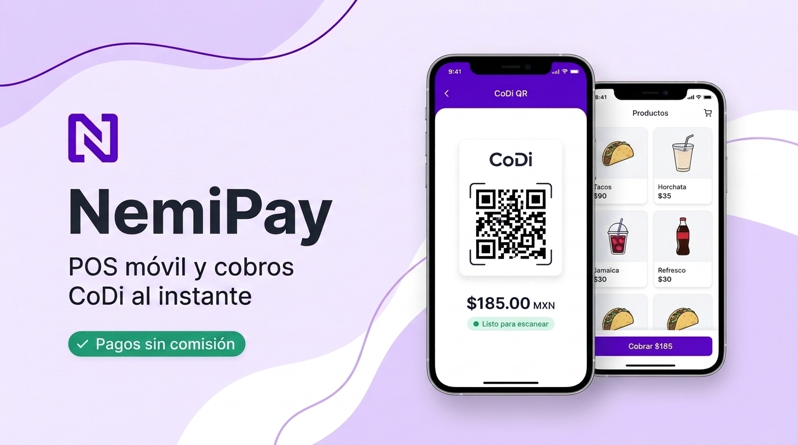

# NemiPay



**NemiPay** es una aplicación móvil y web de cobros digitales con **CoDi** sin comisiones y **Punto de Venta (POS)** diseñada para comercios pequeños y medianos en México (taquerías, tiendas, cafeterías, fruterías y servicios). Construida con **Expo SDK 58** (React Native + Expo Router) y **Supabase** integrado en tiempo real con la API de **Pey**.

---

## Alineación con Hackatón México (`hackatonmexico.com/reglas`)

Este proyecto participa bajo las reglas oficiales del **Hackatón México** (del 14 de noviembre al 12 de diciembre de 2026, portal oficial [`pey.build`](https://pey.build) / [`hackatonmexico.com/reglas`](https://hackatonmexico.com/reglas)):

- **Uso real e integral de la API de Pey (CoDi):**
  - Generación de mensajes de cobro CoDi (`POST /codi/qr`) desde las Edge Functions de Supabase (`create-charge`), tanto para **monto libre** como para **pedidos armados en el POS** (cálculo de totales del lado del servidor para evitar manipulación de precios).
  - Recepción y verificación criptográfica de **webhooks** (`pey-webhook`) bajo el estándar **Standard Webhooks** (`webhook-id`, `webhook-timestamp`, `webhook-signature`), con deduplicación idempotente en `public.webhook_events`.
  - Consulta activa y reconciliación periódica (`check-charge` y `reconcile-charges` con `pg_cron` + `pg_net` + Vault).
- **Experiencia de usuario (UX) orientada al mostrador:**
  - **Dashboard** con resumen de ventas del día en `America/Mexico_City`, accesos rápidos (`Cobrar con QR`, `POS`, `Movimientos`, `Perfil`) y actividad reciente.
  - **POS móvil completo en una sola pantalla** (`/pos`):
    - Pestañas **Productos** y **Categorías** (ambas con CRUD completo en tarjetas de 3 columnas).
    - Toma de fotos con cámara o galería comprimidas automáticamente a **WebP** (`expo-image-picker` + `expo-image-manipulator`) y almacenadas en **Supabase Storage** (`product-images`).
    - **1 tap** agrega productos a **Tu pedido** con barra de ajuste rápido (`-`, cantidad, `+`, quitar); **2 taps** abre edición/eliminación; **Cobrar** abre un resumen editable antes de generar el QR CoDi.
  - **Confirmación instantánea visual y por voz** (`/collect`): código QR CoDi, temporizador, actualización en vivo por **Supabase Realtime**, comprobante detallado y anuncio por voz en español (`expo-speech`, `es-MX`) con pantalla activa en turno (`expo-keep-awake`).
  - **Cuentas compartidas / Split de pagos** (`/bill/[billId]`): tanto desde **Cobro rápido** (`/cobrar`) como desde el **Resumen del POS**, el vendedor puede marcar **Dividir cuenta** y elegir modo **Equitativa** (2–4 personas con reparto entero de residuo), **Personalizada** (etiquetas y montos exactos) o **Libre** (aportaciones hasta completar el total). Cada parte genera su propio cobro CoDi bajo demanda (`MAX_LIVE_SHARES = 2`), actualiza la cuenta por trigger SQL al confirmar el webhook, avanza automáticamente el carrusel y anuncia por voz cada abono y la liquidación total.
  - **Mi perfil y liquidación** (`/profile`): edición de negocio, titular y teléfono; registro de **Cuenta CLABE de 18 dígitos** e institución bancaria; preferencias de notificaciones/voz y cierre de sesión.

### Checklist de entregables para postulación (`pey.build`)

1. **Nombre y descripción del proyecto** (máximo 500 palabras explicando el problema, solución y uso del API de Pey).
2. **Demo pública funcional** (enlace web publicado desde `dist/` o build Expo) con **credenciales de prueba** si requiere inicio de sesión.
3. **Video demostrativo** mostrando el flujo de cobro (POS / monto libre → generación de QR CoDi → confirmación vía webhook y voz).
4. **Repositorio de código fuente** con historial de commits y esta documentación técnica accesible hasta el anuncio de resultados.

---

## Arquitectura del proyecto

```text
app/                                    # Rutas con Expo Router
├── _layout.tsx                         # Bootstrap de sesión, fuentes y QueryClient
├── cobrar.tsx                          # Cobro rápido por monto libre (/cobrar)
├── collect/index.tsx                   # Pantalla de QR CoDi en vivo y comprobante (/collect)
├── (auth)/                             # Welcome, Login y Registro
└── (tabs)/                             # Navegación inferior: Inicio, POS, Movimientos, Perfil

src/
├── features/
│   ├── authentication/                 # Auth Supabase y perfil de comercio (CLABE, notificaciones)
│   ├── dashboard/                      # Resumen diario y accesos rápidos
│   ├── movements/                      # Historial paginado y filtros de cobros
│   ├── payments/                       # Teclado libre, ChargeScreen, PaymentReceivedModal, voz
│   ├── pos/                            # CRUD Productos, CRUD Categorías, WebP upload, carrito POS
│   └── profile/                        # Pantalla Mi perfil (Mis datos, CLABE, Notificaciones, Ayuda)
└── types/database.ts                   # Tipos TypeScript del esquema Supabase

supabase/
├── config.toml                         # Configuración local y verify_jwt de Edge Functions
├── migrations/                         # 6 migraciones SQL (tablas, RLS, funciones, cron, media, CLABE)
├── functions/                          # Edge Functions (Deno): create-charge, check-charge,
│                                       # cancel-charge, pey-webhook, reconcile-charges
└── tests/                              # Pruebas pgTAP de RLS y reglas de negocio
scripts/
└── seed-demo.ts                        # Crea cuenta demo, 4 categorías y 10 productos de taquería
```

---

## Requisitos previos

- **Node.js** `>= 20` (probado en `v24.21.0`) y **npm** `>= 10`.
- Cuenta y proyecto en **[Supabase](https://supabase.com)**.
- Credenciales de API en **[Pey / Hackatón México](https://pey.build)** (`PEY_API_KEY` y `PEY_WEBHOOK_SECRET`).
- _(Opcional)_ **Docker Desktop** + **Supabase CLI** si deseas correr la base de datos en local.
- _(Opcional)_ **Deno** para ejecutar las pruebas unitarias de Edge Functions (`npm run functions:test`).
- Para probar en teléfono: **Expo Go** (o Development Build / EAS Build para compilación nativa).

---

## Instalación completa paso a paso

### 1. Clonar el repositorio e instalar dependencias

```bash
git clone <URL_DEL_REPOSITORIO>
cd nemipay
npm install
```

### 2. Configurar variables de entorno locales (`.env`)

Copia el archivo de ejemplo y rellena tus valores:

```bash
cp .env.example .env
```

En Windows PowerShell:

```powershell
Copy-Item .env.example .env
```

#### Variables del cliente (`.env`)

| Variable                        | Obligatoria | Ejemplo / Default                   | Descripción                                                        |
| ------------------------------- | :---------: | ----------------------------------- | ------------------------------------------------------------------ |
| `EXPO_PUBLIC_APP_ENV`           |     Sí      | `development`                       | Entorno del cliente (`development` o `production`).                |
| `EXPO_PUBLIC_SUPABASE_URL`      |     Sí      | `https://<project-ref>.supabase.co` | URL de tu proyecto (Supabase Dashboard → **Settings → API**).      |
| `EXPO_PUBLIC_SUPABASE_ANON_KEY` |     Sí      | `eyJhbGci...`                       | Llave pública `anon` / `publishable` del proyecto Supabase.        |
| `EXPO_PUBLIC_API_TIMEOUT_MS`    |     No      | `15000`                             | Timeout HTTP hacia Edge Functions (en milisegundos, máx. `60000`). |
| `EXPO_PUBLIC_MAX_CHARGE_CENTS`  |     No      | `9999900`                           | Tope por cobro en centavos (`9999900` = `$99,999.00 MXN`).         |

#### Variables exclusivas para el script de seed (`scripts/seed-demo.ts`)

> **Seguridad:** Estas variables **NUNCA** deben llevar el prefijo `EXPO_PUBLIC_` ni incluirse en el código del cliente. Úsalas únicamente en tu `.env` local para ejecutar el seed.

| Variable                    | Obligatoria para seed | Ejemplo                             | Descripción                                                             |
| --------------------------- | :-------------------: | ----------------------------------- | ----------------------------------------------------------------------- |
| `SUPABASE_URL`              |          Sí           | `https://<project-ref>.supabase.co` | Misma URL del proyecto Supabase.                                        |
| `SUPABASE_SERVICE_ROLE_KEY` |          Sí           | `eyJhbGci...`                       | Llave privada `service_role` (Supabase Dashboard → **Settings → API**). |
| `DEMO_EMAIL`                |          Sí           | `demo@nemipay.mx`                   | Correo de la cuenta demo o de evaluación que se creará.                 |
| `DEMO_PASSWORD`             |          Sí           | `TuPasswordSegura123`               | Contraseña para iniciar sesión en la app con la cuenta demo.            |
| `DEMO_MERCHANT_NAME`        |          No           | `Taquería Demo NemiPay`             | Nombre inicial del comercio en `public.merchants`.                      |

---

### 3. Configurar la base de datos y Storage en Supabase

Enlaza tu proyecto de Supabase y ejecuta todas las migraciones (`supabase/migrations/`):

```bash
npx supabase login
npx supabase link --project-ref <project-ref>
npx supabase db push --linked
```

Esto crea y configura automáticamente:

1. `public.merchants`: comercios (`name`, `owner_name`, `phone`, `clabe` de 18 dígitos, `bank_name`, `notifications_enabled`, `voice_announcements_enabled`).
2. `public.categories`: categorías del POS (`name`, `description`, `image_url`, `active`).
3. `public.products`: productos del POS (`name`, `price_cents`, `description`, `category`, `category_id`, `image_url`, `active`).
4. `public.charges` y `public.webhook_events`: cobros CoDi, idempotencia, eventos webhook y publicación **Supabase Realtime**.
5. Funciones SQL: `apply_charge_transition`, `charges_today()` y `daily_summary()` en zona `America/Mexico_City`.
6. **Supabase Storage (`product-images`)**: bucket público de lectura (límite `5 MB`, formatos `image/webp`, `image/jpeg`, `image/png`) con políticas RLS que permiten subir/editar/borrar únicamente dentro de `<auth.uid()>/...`.

---

### 4. Configurar secretos y desplegar Edge Functions

Configura los secretos del servidor en Supabase (nunca uses prefijo `SUPABASE_` en `secrets set`, ya que Supabase inyecta `SUPABASE_URL` y `SUPABASE_SERVICE_ROLE_KEY` automáticamente en las Edge Functions):

```bash
npx supabase secrets set \
  APP_ENV=production \
  PEY_API_KEY=<tu-api-key-de-pey> \
  PEY_BASE_URL=https://api.pey.mx \
  PEY_WEBHOOK_SECRET=<tu-whsec-de-pey> \
  ALLOWED_ORIGINS=http://localhost:8081,https://tu-dominio-web.com \
  MAX_CHARGE_CENTS=9999900 \
  CHARGE_TTL_SECONDS=600 \
  CRON_SECRET=<secreto-aleatorio-largo>
```

#### Referencia de secretos de las Edge Functions

| Secreto              |   Requerido    | Descripción                                                                                          |
| -------------------- | :------------: | ---------------------------------------------------------------------------------------------------- |
| `PEY_API_KEY`        |  Sí (en prod)  | API Key obtenida en [`pey.build`](https://pey.build).                                                |
| `PEY_BASE_URL`       |       No       | URL base de Pey (por defecto `https://api.pey.mx`).                                                  |
| `PEY_WEBHOOK_SECRET` |  Sí (en prod)  | Secreto `whsec_...` para verificar firmas Standard Webhooks en `pey-webhook`.                        |
| `ALLOWED_ORIGINS`    |  Recomendado   | Lista separada por comas con los orígenes web permitidos para CORS.                                  |
| `MAX_CHARGE_CENTS`   |       No       | Límite máximo por cobro en centavos (default `9999900`).                                             |
| `CHARGE_TTL_SECONDS` |       No       | Tiempo de vigencia del QR CoDi en segundos (default `600` = 10 min).                                 |
| `BILL_TTL_SECONDS`   |       No       | Tiempo de vigencia de cuentas compartidas en segundos (default `600` = 10 min).                        |
| `MAX_LIVE_SHARES`    |       No       | Máximo de QR CoDi activos simultáneos por cuenta compartida (default `2`).                           |
| `CRON_SECRET`        | Sí (para Cron) | Token esperado en el header `x-cron-secret` por `reconcile-charges`.                                 |
| `APP_ENV`            |       Sí       | `production` exige `PEY_API_KEY` real; en `development` sin clave permite usar `_shared/peyFake.ts`. |

Despliega todas las Edge Functions:

```bash
npx supabase functions deploy
```

#### Configurar Cron de reconciliación (Vault) y Webhook de Pey

1. En **Supabase Dashboard → SQL Editor**, guarda los secretos de Vault para el job `pg_cron`:

   ```sql
   select vault.create_secret(
     'https://<project-ref>.supabase.co/functions/v1/reconcile-charges',
     'reconcile_charges_url'
   );
   select vault.create_secret('<CRON_SECRET>', 'cron_secret');
   ```

2. En tu panel de **Pey (`pey.build`)**, registra la URL pública de webhook:

   ```text
   https://<project-ref>.supabase.co/functions/v1/pey-webhook
   ```

---

### 5. Crear cuentas en Supabase y sembrar el catálogo inicial

Por seguridad (`supabase/config.toml` tiene `enable_signup = false` para entorno de demo controlada), cada usuario que inicie sesión en NemiPay necesita:

1. Un usuario en **Supabase Auth** (`auth.users`).
2. Su registro correspondiente en **`public.merchants`** con el mismo `id` (`merchants.id = auth.users.id`).

#### Opción A: Automática con el script de seed (recomendada)

Asegúrate de tener `SUPABASE_URL`, `SUPABASE_SERVICE_ROLE_KEY`, `DEMO_EMAIL`, `DEMO_PASSWORD` y `DEMO_MERCHANT_NAME` en `.env`, y ejecuta:

```bash
node --env-file=.env scripts/seed-demo.ts
```

Este script es idempotente y realiza todo por ti:

- Crea el usuario en `auth.users` con correo confirmado (`email_confirm: true`), o reutiliza el existente.
- Crea/actualiza su perfil en `public.merchants`.
- Siembra **4 categorías de taquería** (`Tacos`, `Bebidas`, `Antojitos`, `Postres`) y **10 productos** (`Tacos de bistec`, `Tacos al pastor`, `Tacos de suadero`, `Tacos de chorizo`, `Quesadilla`, `Tostadas`, `Gringa al pastor`, `Refresco`, `Agua de horchata`, `Flan napolitano`) listos para usar en el POS.

#### Opción B: Crear una cuenta nueva manualmente desde Supabase Dashboard

1. Ve a **Authentication → Users → Add user → Create new user**.
2. Ingresa correo y contraseña y activa **Auto Confirm User**.
3. Copia el **User UID** generado y ejecuta en **SQL Editor**:

   ```sql
   insert into public.merchants (id, name, owner_name)
   values ('<USER_UID>', 'Nombre de tu negocio', 'Nombre del titular')
   on conflict (id) do nothing;
   ```

4. En **Authentication → URL Configuration**, agrega tu URL web de producción (o `http://localhost:8081` en local) en **Site URL** y **Redirect URLs**.
5. Si deseas habilitar registro abierto desde la app, activa **Allow new users to sign up** en **Authentication → Providers → Email**.

---

### 6. Ejecutar la aplicación (Móvil y Web)

```bash
# Iniciar servidor de desarrollo Expo
npx expo start

# Abrir directamente en plataforma específica
npm run android
npm run ios
npm run web
```

> **Nota para móvil nativo:** Como el módulo POS utiliza `expo-image-picker` y `expo-image-manipulator`, si ejecutas fuera de Expo Go con un Development Build o build nativo, compila nuevamente con `npx expo run:android`, `npx expo run:ios` o **EAS Build** (`npx eas-cli@latest build`).

---

## Pruebas, calidad de código y build web

```bash
npm run typecheck        # Verificación estricta de TypeScript (tsc --noEmit)
npm run lint             # ESLint + Prettier vía Expo (expo lint)
npm test                 # Suite Jest + React Native Testing Library (17 suites)
npm run format:check     # Verificar formato con Prettier
npm run functions:test   # Pruebas Deno de Edge Functions (requiere Deno)
npm run build:web        # Genera bundle web estático en dist/
```

### Base de datos local con Docker (opcional)

```bash
npm run db:start         # Levanta Supabase local (Docker Desktop requerido)
npm run db:reset         # Aplica migraciones limpias en local
npm run db:lint          # Valida esquema SQL
npm run db:test          # Ejecuta pruebas pgTAP en supabase/tests/
npm run db:types         # Regenera src/types/database.ts desde local
```

Antes de publicar o enviar tu entrega a `pey.build`, revisa **Security Advisor** y **Performance Advisor** en el dashboard de Supabase para confirmar cero alertas de RLS o índices.
